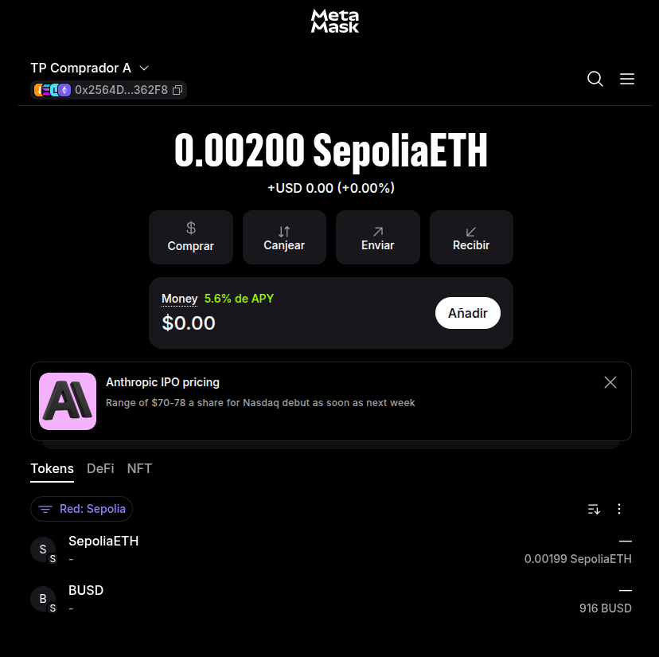
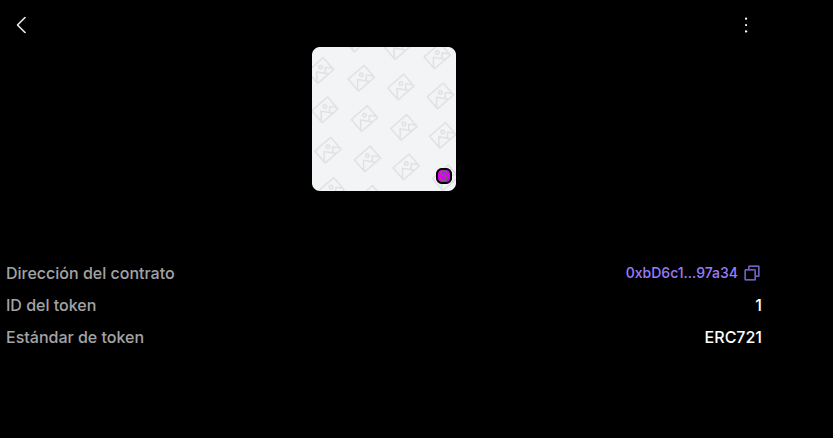

# Guía de entrega local — CryptoCampo NFT

La entrega reúne implementación, fundamentos y evidencia del recorrido público. La fase 7 conserva su cierre académico con la limitación visual de MetaMask. La fase 8 tiene documentación local preparada; la reproducción actual está bloqueada por DNS y sockets. La publicación de estos cambios y su comprobación desde GitHub siguen pendientes. Ver la [matriz completa de la consigna](matriz-entrega.md) y el [informe de validación actual](entrega-validacion-2026-11-16.md).

## Contratos y actores

Red **Sepolia**, chain ID **11155111**. Las respuestas Etherscan conservadas acreditan compilador `v0.8.19+commit.7dd6d404`, optimizador 200 runs, EVM Paris y constructores sin argumentos. La revisión del 16/11 se limita a archivos locales: no es una consulta nueva al explorador ni una lectura actual de Sepolia.

| Contrato | Código verificado |
| --- | --- |
| BUSD | [0x2a37e9ac75569eea1537bdb7ba6beb5b6cd8f710](https://sepolia.etherscan.io/address/0x2a37e9ac75569eea1537bdb7ba6beb5b6cd8f710#code) |
| CCNFT | [0xbd6c1c5f5690d92021bff186597c2b71daf97a34](https://sepolia.etherscan.io/address/0xbd6c1c5f5690d92021bff186597c2b71daf97a34#code) |

Fuente: [respuestas y hashes de verificación](evidence/sepolia-verified-2026-11-15/review.json).

| Actor | Dirección |
| --- | --- |
| admin | `0xb2817d3b1d33671241626d1e6e077822c391ebd5` |
| a | `0x2564dc8376be1e561086797e66835202d78362f8` |
| b | `0x0213484c8aab12035c5fd0164b23040af2638e13` |
| funds | `0xfb989ba65989f28c48cd389611d4380ba57688cf` |
| fees | `0x76c59958ec73e45a575505ab2b570dce880f555e` |

## Las 26 transacciones exitosas

La tabla sigue el orden de los scripts y del historial conservado. Los importes de BUSD están expresados de forma legible; los argumentos monetarios reales usan `10^18` unidades por BUSD. Cada enlace corresponde a un recibo conservado con `status=0x1`. La verificación de fuentes en Etherscan es una consulta/API, sin transacción adicional.

| N.º | Etapa / operación | Transacción Sepolia Etherscan | Evidencia local |
| ---: | --- | --- | --- |
| 1 | `Desplegar BUSD` | [0x35f2d2609f76de72366c3b21fac4d39052e8df0c8f2ab0b94d3246eee83ee114](https://sepolia.etherscan.io/tx/0x35f2d2609f76de72366c3b21fac4d39052e8df0c8f2ab0b94d3246eee83ee114) | [Informe deploy](evidence/sepolia-journey-2026-11-15/deploy/result.json) |
| 2 | `Desplegar CCNFT` | [0xbe5bfb3b8aaca4fd3ba1297b2a3dc33a1e6d196a0623863904a551426747b12d](https://sepolia.etherscan.io/tx/0xbe5bfb3b8aaca4fd3ba1297b2a3dc33a1e6d196a0623863904a551426747b12d) | [Informe deploy](evidence/sepolia-journey-2026-11-15/deploy/result.json) |
| 3 | `setFundsToken(BUSD)` | [0xfff66f0338c2935c99cb143f1b7bf93ecde72416b5531e76222f6c9fd0d6e4ae](https://sepolia.etherscan.io/tx/0xfff66f0338c2935c99cb143f1b7bf93ecde72416b5531e76222f6c9fd0d6e4ae) | [Informe configure](evidence/sepolia-journey-2026-11-15/configure/result.json) |
| 4 | `setFundsCollector(fondos)` | [0xc903baac941c5003d6de991eee1aa9cd0d955ddf35f2f0935122c6c76c27babc](https://sepolia.etherscan.io/tx/0xc903baac941c5003d6de991eee1aa9cd0d955ddf35f2f0935122c6c76c27babc) | [Informe configure](evidence/sepolia-journey-2026-11-15/configure/result.json) |
| 5 | `setFeesCollector(comisiones)` | [0x4065bd4271fed72b9d3cf3ae2a2f4325715407f7c0ec39bb6292874bcf3f9095](https://sepolia.etherscan.io/tx/0x4065bd4271fed72b9d3cf3ae2a2f4325715407f7c0ec39bb6292874bcf3f9095) | [Informe configure](evidence/sepolia-journey-2026-11-15/configure/result.json) |
| 6 | `addValidValues(100 BUSD)` | [0xcf28fcb4f6135b93d89523aa923c4f62a664f4cf9cbe8f1f7e4bf481d19a2d5b](https://sepolia.etherscan.io/tx/0xcf28fcb4f6135b93d89523aa923c4f62a664f4cf9cbe8f1f7e4bf481d19a2d5b) | [Informe configure](evidence/sepolia-journey-2026-11-15/configure/result.json) |
| 7 | `addValidValues(500 BUSD)` | [0x4cf3e22b6d1257855aa0b5dc32959f7aa1ea3ffd7f03f685b37f7bb6d6741df1](https://sepolia.etherscan.io/tx/0x4cf3e22b6d1257855aa0b5dc32959f7aa1ea3ffd7f03f685b37f7bb6d6741df1) | [Informe configure](evidence/sepolia-journey-2026-11-15/configure/result.json) |
| 8 | `setBuyFee(200)` | [0xdf139e23a93d47c6d89a4cadeeb4e9201b0aeffad02047e70bce5b67314c5fb6](https://sepolia.etherscan.io/tx/0xdf139e23a93d47c6d89a4cadeeb4e9201b0aeffad02047e70bce5b67314c5fb6) | [Informe configure](evidence/sepolia-journey-2026-11-15/configure/result.json) |
| 9 | `setTradeFee(100)` | [0x50f0dcb1f688b2f90779fa2b25476d6e5372601235c1028302b2d770be5d3ad7](https://sepolia.etherscan.io/tx/0x50f0dcb1f688b2f90779fa2b25476d6e5372601235c1028302b2d770be5d3ad7) | [Informe configure](evidence/sepolia-journey-2026-11-15/configure/result.json) |
| 10 | `setProfitToPay(500)` | [0xbd0605014ebcf97fc21ccf351341e8d5e1bbdb35c59e80d790bb9b80424fb638](https://sepolia.etherscan.io/tx/0xbd0605014ebcf97fc21ccf351341e8d5e1bbdb35c59e80d790bb9b80424fb638) | [Informe configure](evidence/sepolia-journey-2026-11-15/configure/result.json) |
| 11 | `setMaxBatchCount(10)` | [0xd1ac1b8283a0c764440430f9227bd49246e70298fd35da392818f86d7c228b45](https://sepolia.etherscan.io/tx/0xd1ac1b8283a0c764440430f9227bd49246e70298fd35da392818f86d7c228b45) | [Informe configure](evidence/sepolia-journey-2026-11-15/configure/result.json) |
| 12 | `setMaxValueToRaise(10.000 BUSD)` | [0x6c8c18679b270c72fdf24d5d8f305a7784e92cb26c4b6584067d204f0dde9103](https://sepolia.etherscan.io/tx/0x6c8c18679b270c72fdf24d5d8f305a7784e92cb26c4b6584067d204f0dde9103) | [Informe configure](evidence/sepolia-journey-2026-11-15/configure/result.json) |
| 13 | `setMetadataURI(URI IPFS definitiva)` | [0xe10e49b590f411442ecf2765db63b3e676033e436b4b6010693e6ccfdfedadd1](https://sepolia.etherscan.io/tx/0xe10e49b590f411442ecf2765db63b3e676033e436b4b6010693e6ccfdfedadd1) | [Informe configure](evidence/sepolia-journey-2026-11-15/configure/result.json) |
| 14 | `BUSD.transfer(A, 1.000)` | [0xe16f2fb53229d7bcce259934d3a0b308123e155b1d894cf7c1ab373dea50efa3](https://sepolia.etherscan.io/tx/0xe16f2fb53229d7bcce259934d3a0b308123e155b1d894cf7c1ab373dea50efa3) | [Informe fund](evidence/sepolia-journey-2026-11-15/fund/result.json) |
| 15 | `BUSD.transfer(B, 1.000)` | [0x8c79e1e35f5ff4dae0521de8609836be24b3ace633bfa28ec5bde138260d5cd8](https://sepolia.etherscan.io/tx/0x8c79e1e35f5ff4dae0521de8609836be24b3ace633bfa28ec5bde138260d5cd8) | [Informe fund](evidence/sepolia-journey-2026-11-15/fund/result.json) |
| 16 | `BUSD.transfer(fondos, 10)` | [0x63cb2af4ebb5e31d50488d8c1497b1fac553c7cc7c62842cfd4d9462753f4c0d](https://sepolia.etherscan.io/tx/0x63cb2af4ebb5e31d50488d8c1497b1fac553c7cc7c62842cfd4d9462753f4c0d) | [Informe fund](evidence/sepolia-journey-2026-11-15/fund/result.json) |
| 17 | `A: BUSD.approve(CCNFT, 204)` | [0xa62ba20d493902ce29966faa924db0f19debf71846fdc8552c2e2dd911693172](https://sepolia.etherscan.io/tx/0xa62ba20d493902ce29966faa924db0f19debf71846fdc8552c2e2dd911693172) | [Informe approve-a](evidence/sepolia-journey-2026-11-15/approve-a/result.json) |
| 18 | `B: BUSD.approve(CCNFT, 121,2)` | [0xd6cdcc94cf51341ca5716ec94dc4c931bc79eb35ae5fb5969bd048a619b9fb64](https://sepolia.etherscan.io/tx/0xd6cdcc94cf51341ca5716ec94dc4c931bc79eb35ae5fb5969bd048a619b9fb64) | [Informe approve-b](evidence/sepolia-journey-2026-11-15/approve-b/result.json) |
| 19 | `Fondos: BUSD.approve(CCNFT, 105)` | [0x415fd6a624f133c1b4120088121920d7b76b8c69be440262faea2d408fa82eff](https://sepolia.etherscan.io/tx/0x415fd6a624f133c1b4120088121920d7b76b8c69be440262faea2d408fa82eff) | [Informe approve-funds](evidence/sepolia-journey-2026-11-15/approve-funds/result.json) |
| 20 | `setCanBuy(true)` | [0x05010207a2f7ec38385a5834090bd428161beccc25ddb7d8e8d55315b60ee6ca](https://sepolia.etherscan.io/tx/0x05010207a2f7ec38385a5834090bd428161beccc25ddb7d8e8d55315b60ee6ca) | [Informe enable](evidence/sepolia-journey-2026-11-15/enable/result.json) |
| 21 | `setCanTrade(true)` | [0x8ba40691096626d914ada7c70dba4b0c253b85dc35647304817f0fe91b74f7e2](https://sepolia.etherscan.io/tx/0x8ba40691096626d914ada7c70dba4b0c253b85dc35647304817f0fe91b74f7e2) | [Informe enable](evidence/sepolia-journey-2026-11-15/enable/result.json) |
| 22 | `setCanClaim(true)` | [0x4fd67788ff10b9863900b9bba94d3a48ccbdd305ca668c8fc39ac3ca7a19d48d](https://sepolia.etherscan.io/tx/0x4fd67788ff10b9863900b9bba94d3a48ccbdd305ca668c8fc39ac3ca7a19d48d) | [Informe enable](evidence/sepolia-journey-2026-11-15/enable/result.json) |
| 23 | `A: buy(100 BUSD, 2)` | [0x15aa3c4a104213e3fa4afdb00ac4fccda5937c557b1eaef7eb75277ad8711b3b](https://sepolia.etherscan.io/tx/0x15aa3c4a104213e3fa4afdb00ac4fccda5937c557b1eaef7eb75277ad8711b3b) | [Informe buy](evidence/sepolia-journey-2026-11-15/buy/result.json) |
| 24 | `A: putOnSale(0, 120 BUSD)` | [0xaf41f580e9d57cf1bc3f9ecc569bf559f18f5bee4623cb791dca28fc496ffa2b](https://sepolia.etherscan.io/tx/0xaf41f580e9d57cf1bc3f9ecc569bf559f18f5bee4623cb791dca28fc496ffa2b) | [Informe list](evidence/sepolia-journey-2026-11-15/list/result.json) |
| 25 | `B: trade(0)` | [0x48ea857434da110b1acb5e6724044f66eccdf40395d526c6d2ce0e70a14f1f34](https://sepolia.etherscan.io/tx/0x48ea857434da110b1acb5e6724044f66eccdf40395d526c6d2ce0e70a14f1f34) | [Informe trade](evidence/sepolia-journey-2026-11-15/trade/result.json) |
| 26 | `B: claim([0])` | [0xf1f5b0dac79a7e401d26e6bd12e258ecad0f7964e7721c20e6ac4b2d7d631dc9](https://sepolia.etherscan.io/tx/0xf1f5b0dac79a7e401d26e6bd12e258ecad0f7964e7721c20e6ac4b2d7d631dc9) | [Informe claim](evidence/sepolia-journey-2026-11-15/claim/result.json) |

El primer CREATE fallido, `0xaea382d25998854741a517145c8911a9ef8870710b19afbe4677e104f0b6c523`, está [documentado por separado con su recuperación](evidence/sepolia-rpc-gas-fix-2026-11-15/review.json) y no integra los 26 éxitos. No se borró ni se sumó al conteo de recibos exitosos.

## Estado final y financiación

El informe final `20261115T233639275750Z` tiene **55 controles aprobados**. A conserva el NFT **1**, nominal 100 BUSD; el NFT **0** se revendió y quemó mediante `claim([0])`. Se comprobó nominal quemado cero, publicación eliminada, lista de ventas vacía, suministro NFT 1 y `totalValue = 100 * 10^18`. Las autorizaciones de A/B/fondos se consumieron y CCNFT terminó sin custodia BUSD.

| Cuenta | Saldo final BUSD | Variación desde financiación |
| --- | ---: | ---: |
| Administrador | 9.997.990 | 0 |
| A | 916 | −84 |
| B | 983,8 | −16,2 |
| Fondos | 105 | +95 |
| Comisiones | 5,2 | +5,2 |

Los saldos suman los 10.000.000 BUSD emitidos. El administrador distribuyó 1.000 a A, 1.000 a B y 10 a fondos. La compra llevó 200 a fondos y 4 a comisiones; la reventa llevó 120 a A y 1,2 a comisiones; el reclamo pagó 105 a B. Las variaciones suman cero. La reserva final alcanza para otro reclamo de 105 si el colector vuelve a aprobar CCNFT; el beneficio configurado no genera fondos. Ver [unidades y reglas](../README.md#operaciones-y-reglas-económicas).

Fuentes: [comprobación final](evidence/sepolia-journey-2026-11-15/final-check/result.json) y [revisión del recorrido, recibos y manifiesto de 796 archivos](evidence/sepolia-journey-2026-11-15/review.json).

## Capturas originales

Los PNG se conservan sin recortar ni editar; sus hashes vuelven a coincidir con la revisión original. La imagen BUSD muestra A/Sepolia y 916 BUSD. La vista del NFT muestra CCNFT abreviado, ID 1 y ERC721; la propiedad de A se acredita con el informe final. No muestran claves ni frases de recuperación.

**Limitación:** MetaMask no renderiza la imagen del certificado. La importación está documentada y el README de la consigna no exige expresamente ese render. Se conserva la captura real; no se atribuye una causa técnica confirmada. El usuario informó acceso al JSON y a la imagen desde el navegador; no equivale a una nueva descarga automatizada. Ver [revisión visual y hashes](evidence/metamask-import-2026-11-15/review.json) y [explicación de fase 7](sepolia-results.md).

El [certificado local](../assets/certificate.svg) y el [JSON local](../assets/metadata.json) corresponden a los recursos publicados en IPFS. La URI definitiva es `ipfs://bafkreihjmwkav7thv25yhsosaemqlvn5necgydfkofak7dl5zel3zuw5t4`. [La comprobación histórica de gateways](ipfs-verification-2026-11-15.md) conserva bytes y hashes; ambos recursos deben permanecer fijados.

## Validación y reproducción

| Control | Evidencia y alcance |
| --- | --- |
| Revisión actual del 16/11 | 49 pruebas Solidity, cuatro fuzz × 256, 70 Python, compilación/formato, cobertura base y reporte de gas aprobados. [Resultados y logs](entrega-validacion-2026-11-16.md). |
| Cobertura CCNFT | 122/122 líneas, 116/116 sentencias, 25/25 funciones, 79/81 ramas. [Justificación de dos guardas de trade inalcanzables](ci-validation-2026-11-15.md). |
| Gas y Anvil actuales | Matriz y ambos recorridos intentados: bloqueados por permisos de sockets, sin nuevos recibos exitosos. |
| Instalación limpia actual | Copia de contenido entregable sin `.env`, bibliotecas, herramientas ni cachés; instalación bloqueada por DNS de GitHub. No se declara reproducción aprobada. |
| Antecedentes de gas y Anvil | [35 mediciones](gas-scenarios.md), [dos redes / 52 recibos / 838 controles](local-demo-validation.md) y [validación integral histórica de los scripts adaptados](evidence/sepolia-local-complete-2026-11-15/review.json). Son ejecuciones anteriores identificadas, no resultados nuevos. |
| Integridad local de fase 7 | 796 archivos de recorrido, 14 de verificación, dos capturas y 26 recibos contrastados; [revisión actual](entrega-validacion-2026-11-16.md). |

## Entrega pendiente de publicación

Repositorio de referencia: [FacundoBustelo/cryptocampo](https://github.com/FacundoBustelo/cryptocampo). Los cambios de esta entrega permanecen locales; el enlace existente no acredita que ya estén publicados. Para completar fase 8 faltan la instalación/validación limpias en un entorno con red y sockets, publicar el contenido revisado y verificar desde un clon del repositorio publicado. El [informe actual](entrega-validacion-2026-11-16.md) incluye comandos y criterios concretos. No se ejecutaron push ni operaciones públicas en esta preparación.
