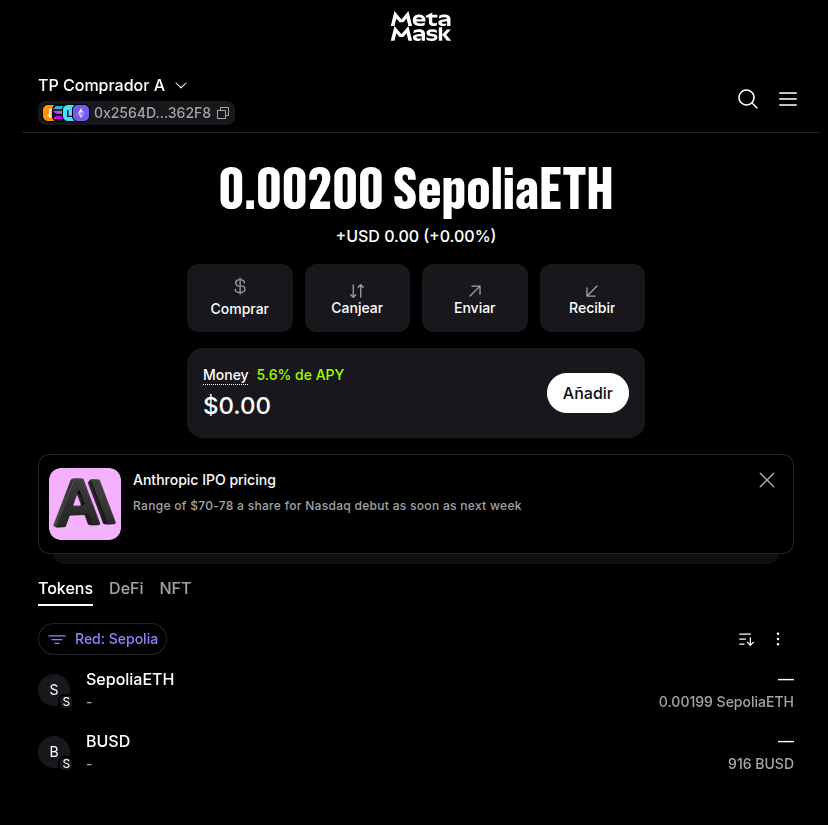
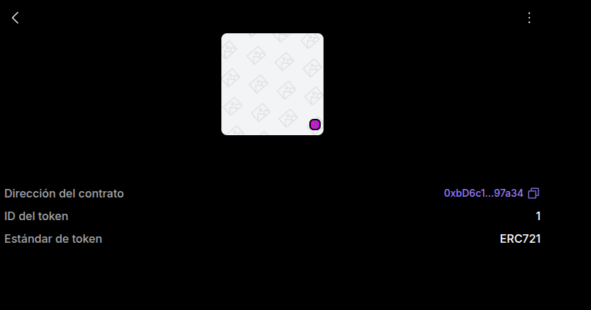

# Resultado de fase 7 — Sepolia y MetaMask

**Fase 7 completada dentro del alcance académico, con una limitación visual documentada.** Los dos contratos están verificados en Etherscan, las once etapas públicas finalizaron y se revisaron las dos capturas originales de importación en MetaMask. El certificado aparece como un marcador genérico dentro de MetaMask; no se afirma que la billetera haya renderizado su imagen. El usuario pudo abrir la imagen y los metadatos desde su navegador.

## Contratos verificados

| Contrato | Dirección en Sepolia |
| --- | --- |
| BUSD | [0x2a37e9ac75569eea1537bdb7ba6beb5b6cd8f710](https://sepolia.etherscan.io/address/0x2a37e9ac75569eea1537bdb7ba6beb5b6cd8f710#code) |
| CCNFT | [0xbd6c1c5f5690d92021bff186597c2b71daf97a34](https://sepolia.etherscan.io/address/0xbd6c1c5f5690d92021bff186597c2b71daf97a34#code) |

Las respuestas de Etherscan conservadas acreditan Solidity `v0.8.19+commit.7dd6d404`, optimizador habilitado con 200 runs, EVM Paris y constructores sin argumentos. OpenZeppelin 4.5.0, parámetros económicos y URI definitiva se conservaron.

## Recorrido público

La ejecución por etapas del usuario terminó con `sepolia-check` aprobado en `20261115T233639275750Z`. Se inspeccionaron directamente los informes y **26 recibos exitosos**: dos despliegues, once configuraciones, tres transferencias BUSD, tres aprobaciones, tres habilitaciones y compra, publicación, reventa y reclamo. La comprobación final contiene 55 controles aprobados y el manifiesto de fuentes sigue coincidiendo con los archivos ejecutados.

| Operación | Transacción exitosa |
| --- | --- |
| `buy` | [0x15aa3c4a104213e3fa4afdb00ac4fccda5937c557b1eaef7eb75277ad8711b3b](https://sepolia.etherscan.io/tx/0x15aa3c4a104213e3fa4afdb00ac4fccda5937c557b1eaef7eb75277ad8711b3b) |
| `list` | [0xaf41f580e9d57cf1bc3f9ecc569bf559f18f5bee4623cb791dca28fc496ffa2b](https://sepolia.etherscan.io/tx/0xaf41f580e9d57cf1bc3f9ecc569bf559f18f5bee4623cb791dca28fc496ffa2b) |
| `trade` | [0x48ea857434da110b1acb5e6724044f66eccdf40395d526c6d2ce0e70a14f1f34](https://sepolia.etherscan.io/tx/0x48ea857434da110b1acb5e6724044f66eccdf40395d526c6d2ce0e70a14f1f34) |
| `claim` | [0xf1f5b0dac79a7e401d26e6bd12e258ecad0f7964e7721c20e6ac4b2d7d631dc9](https://sepolia.etherscan.io/tx/0xf1f5b0dac79a7e401d26e6bd12e258ecad0f7964e7721c20e6ac4b2d7d631dc9) |

El NFT 0 fue comprado por A, publicado a 120 BUSD, revendido a B y reclamado por 105 BUSD. Quedó quemado, con nominal y publicación limpios. A conserva el NFT **1**, nominal **100 BUSD**, con la URI definitiva `ipfs://bafkreihjmwkav7thv25yhsosaemqlvn5necgydfkofak7dl5zel3zuw5t4`.

| Actor | Saldo final BUSD | Variación desde la financiación |
| --- | ---: | ---: |
| Comprador A | 916 | -84 |
| Comprador B | 983,8 | -16,2 |
| Colector de fondos | 105 | +95 |
| Colector de comisiones | 5,2 | +5,2 |

El nominal total final es 100 BUSD, las autorizaciones de A/B/fondos son cero y la lista de ventas está vacía. El colector conserva 105 BUSD. El estado termina sin una etapa pendiente.

El primer CREATE falló por consumir todo el gas asignado y se conserva separado de los éxitos. Se corrigieron la coherencia de comisiones y el uso de estimación RPC al publicar; la recuperación explícita verificó el fallo y preparó nonces nuevos sin repetir despliegues exitosos. Ver [recuperación y pruebas](evidence/sepolia-rpc-gas-fix-2026-11-15/review.json). Las correcciones aprobaron 70 pruebas Python. La validación integral local previa del usuario aprobó los 21 controles, 49 pruebas Solidity, 35 mediciones de gas y dos demostraciones Anvil; esa ejecución corresponde a la versión previa a las correcciones del ejecutor público.

## Capturas originales de MetaMask

Se copiaron los PNG sin recortes ni alteraciones y se comprobaron sus hashes contra los originales. No contienen claves ni el archivo de entorno.

### BUSD importado

La captura muestra **TP Comprador A**, dirección abreviada compatible con A, filtro **Red: Sepolia** y **916 BUSD**, coincidentes con el estado final comprobado.

### CCNFT importado

La captura muestra **ID 1**, estándar **ERC721** y dirección abreviada compatible con CCNFT. La propiedad de A está acreditada por las consultas en cadena. El nombre de la cuenta no aparece en esta vista de detalle.

### Limitación de presentación

MetaMask conserva un marcador genérico en lugar de la imagen del certificado. El usuario comprobó el acceso al [certificado en IPFS](https://gateway.pinata.cloud/ipfs/bafkreidkykrr5euk77wd3srhwatez6bfrkre5jv775mjggz6wx6sihrhd4), al [JSON por Pinata](https://gateway.pinata.cloud/ipfs/bafkreihjmwkav7thv25yhsosaemqlvn5necgydfkofak7dl5zel3zuw5t4) y al [JSON por dweb.link](https://bafkreihjmwkav7thv25yhsosaemqlvn5necgydfkofak7dl5zel3zuw5t4.ipfs.dweb.link/). Esto se registra como confirmación del usuario; la sesión del agente no obtuvo una nueva descarga HTTP verificable. La causa exacta dentro de MetaMask permanece sin confirmar.

Se releyeron las indicaciones originales de entrega: piden capturas de CCNFT y BUSD **importados a MetaMask**, sin exigir expresamente el render de la imagen. El cierre acredita esa importación y documenta su limitación visual. El certificado externo no se presenta como una captura de la billetera. No se modificaron contratos, imagen, metadatos ni URI para ocultar el problema.

## Evidencia conservada

- [Recorrido público completo, contratos, recibos, enlaces y hashes de 796 archivos](evidence/sepolia-journey-2026-11-15/review.json).
- [Comprobación final de Sepolia](evidence/sepolia-journey-2026-11-15/final-check/result.json).
- [Verificación de código fuente en Etherscan](evidence/sepolia-verified-2026-11-15/review.json).
- [Revisión visual y hashes de las capturas originales](evidence/metamask-import-2026-11-15/review.json).
- [Validación local integral aportada por el usuario](evidence/sepolia-local-complete-2026-11-15/review.json).

La fase 8 corresponde a la revisión final de documentación, preparación del repositorio para entrega y publicación en GitHub.
